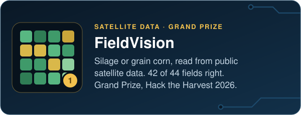
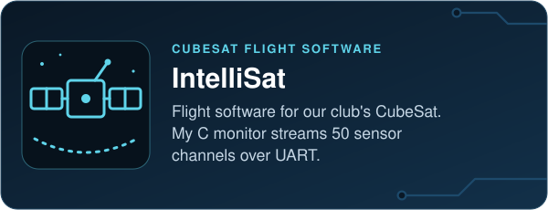
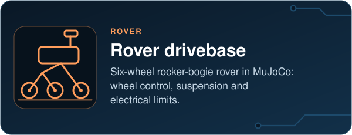
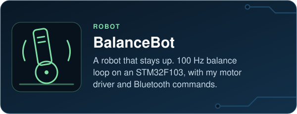
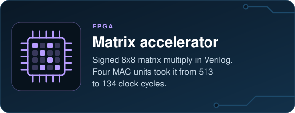
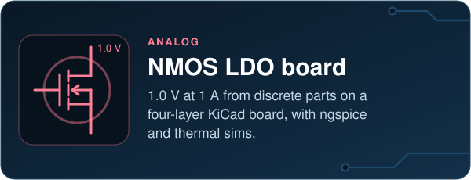
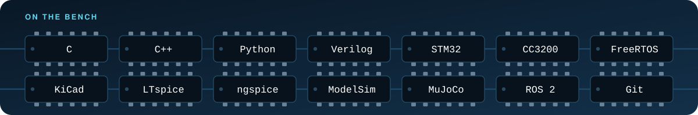

  

I study electrical and computer engineering at UC Davis. I like the place where code meets hardware, and the bugs that only show up on the real thing, like the cart that sped up when I pushed it because one sign in the velocity loop was wrong.

These days I work on the rover's electronics and the CubeSat's flight software with [Space and Satellite Systems](https://github.com/Space-and-Satellite-Systems-UC-Davis).

  
  
  
  
  
  

  More on the shelf:
  <a href="https://github.com/ChenSiyun1234/cc3200-balancing-cart">CC3200 balancing cart</a> ·
  <a href="https://github.com/ChenSiyun1234/insertion-axis-force-sim">force-limited insertion axis</a> ·
  <a href="https://github.com/ChenSiyun1234/cmos-inverter-characterization">CMOS inverters vs LTspice</a> ·
  <a href="https://github.com/ChenSiyun1234/unix-shell-cpp">a small Unix shell</a>

  

  <a href="https://www.linkedin.com/in/siyun-chen-691122342">LinkedIn</a>

